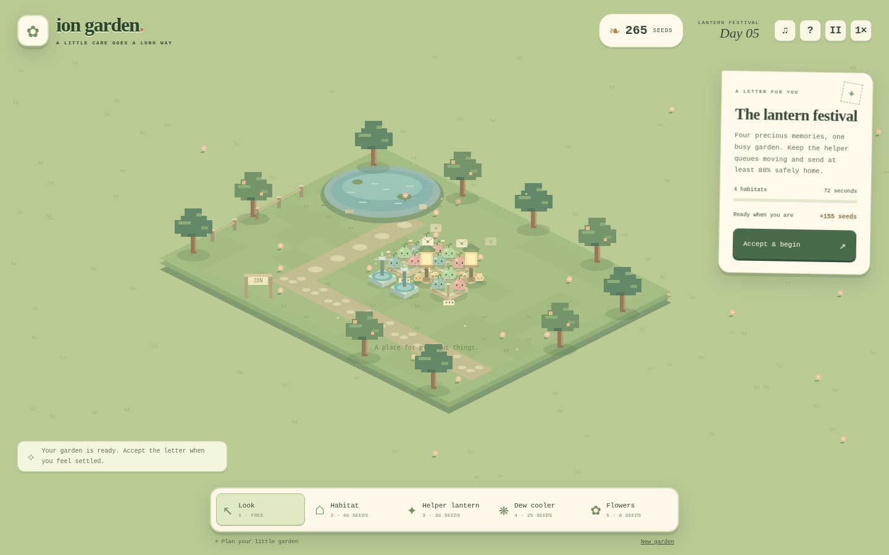

# Ion Garden

A cozy, playable quantum management game. Grow a little garden of ion slimes, place equipment, accept memory-care contracts, and keep your helper stations from getting overwhelmed. The garden is the game screen; there is no required circuit editor or technical dashboard.



## Play

**Download and double-click `PLAY.html`.** Everything is inside that file: no installation, account, API key, internet connection, or server is needed. Desktop/laptop is the recommended experience; a compact touch layout is included.

For the separate source files:

```sh
cd ion-garden
python3 server.py
```

Open `http://127.0.0.1:8002`. You can choose another port with `--port`.

Browser saves are best-effort. Some browsers restrict storage on local files; use the server for a stable origin. If storage is unavailable, gameplay continues in memory. Hidden tabs pause, and a saved active contract resumes paused. New Garden asks before replacing your save.

## Your first few minutes

1. Open the garden. Select **Helper lantern**, then click an empty tile beside the existing habitat. Its pale service circle shows its reach.
2. Plant a **Dew cooler** near the habitat. This is optional, but makes care more reliable.
3. Select **Look**, then **Accept & begin** on the letter. Helpers start checking the shared memory. Little parcels fly home as deliveries complete.
4. Use earned seeds to add another habitat. Follow the next letter, expand helper capacity, and complete four contracts ending with the lantern festival.

Helpers correct errors automatically. You manage equipment, coverage, workload, and checking schedules. Select a habitat to adjust its care rhythm. Frequent care can cause queues; gentle care gives errors longer to accumulate. Failed contracts still award seeds so you can improve and retry. Flowers are purely decorative. After the fourth letter, you can keep gardening and repeat the festival contract.

| Control | Action |
|---|---|
| Cursor / touch | Select a tool and plant equipment; select existing equipment with Look |
| 1–5 | Look, habitat, helper lantern, dew cooler, flowers |
| Space | Pause / resume |
| B | Pocket guide |
| Escape | Return to Look |
| Arrow keys + Enter, with the garden focused | Choose a tile and plant / inspect |
| 1× / 2× button | Change simulation speed |

## The quantum model

Three physical ion qubits encode one logical qubit as `α|000⟩ + β|111⟩`. They are not independent copies. Two helper ancillas extract `q0 XOR q1` and `q0 XOR q2`. Recovery assumes at most one X error: `00 → none`, `11 → q0`, `10 → q1`, `01 → q2`.

The simulation tracks repeated stochastic X errors as a Pauli frame. For this chosen error family, frame tracking is equivalent to executing the encoded quantum circuit. Helper jobs take time, share a finite queue, and may have simulated syndrome-readout and correction-operation errors. Cooling reduces the configured error probabilities; it does not restore a lost memory. Idle-time errors use Poisson hazards. Equipment costs, rates, distances, and the summer breeze are designed gameplay abstractions, not calibrated IonQ hardware parameters.

Every delivered memory is decoded and evaluated by an exact five-qubit statevector model against six reference states: `|0⟩`, `|1⟩`, `|±⟩`, `|±i⟩`. An intact memory scores 1; a logical X scores a six-state mean fidelity of 1/3 and counts as a damaged delivery. Internal error masks are hidden during care and revealed in exported delivery reports. A quiet syndrome cannot distinguish a logical X from an intact codeword.

Each parcel begins a fresh memory; each memory receives multiple correction rounds. The first letter lasts 36 simulated seconds, then 48, 60, and 72. Last helper jobs can take up to six additional simulated seconds to settle. The required safe-delivery fractions are two of three deliveries (about 67%), 75%, 78%, and 80%. This limited repetition code protects against bit flips, **not phase errors or arbitrary quantum noise**. The game does not claim fault tolerance, quantum speedup, or accurate hardware reliability.

The visual mapping is intentionally whimsical: habitats represent trap modules, lantern beams represent control/readout operations, and dew equipment represents improved motional cooling and control quality. Biological slimes, gardens, seeds, and postal deliveries are fiction. The service-radius rule models equipment access, not an assertion that neighboring ions are the only ones that can interact.

## Qollab version

`qollab/` is a generated **JS / Qiskit** project. Create a project on Qollab and copy the **contents** of that folder into its root: `index.html`, `main.css`, `main.js`, `quantum/__init__.py`, and `quantum/garden.py`. Choose a free simulator.

Before the first contract, the Python bridge uses Qiskit circuits to compute all 32 combinations of physical error masks and observed syndromes. Those resulting recovery rules are installed into the actual gameplay recovery path. It also submits one measured recovery circuit to the selected simulator with 128 shots. Sampled backend counts are separate from the ideal game diagnostics. The adapter allows one submission attempt per project run; rerun the project after a failed attempt. It deliberately rejects hardware. Local browser play uses the equivalent JavaScript recovery rule and needs no Qiskit installation.

**Verified:** Qiskit 2.5.2 `Statevector` kernel, all 32 rules, `BasicSimulator` backend call, generated JavaScript parsing/rendering in Chromium, and a mocked Python bridge that installed the kernel and ran a contract. **Not verified:** actual Qollab upload, its live JavaScript/Python bridge, sandbox rendering/input/storage, or IonQ simulator execution. This is a submission-oriented export, not a published or validated hackathon submission. A project page, public demo video, and live platform test are still required.

Build all packages after changing source:

```sh
python3 tools/build.py
```

This generates `PLAY.html`, the static `dist/index.html`, and the Qollab project. Generated launchers should be rebuilt rather than edited.

## Validation

```sh
npm test
python3 -m pip install -r requirements.txt
node tests/qiskit_fixtures.mjs | python3 tests/qiskit_crosscheck.py
```

The review run passed **256 independent browser/Qiskit fidelity comparisons**, all 32 kernel comparisons, and a 128-shot BasicSimulator adapter call. JavaScript tests cover correction/failure cases, conservation of normalization, placement/economy, contract requirements, delivery progression, helper fairness, cooling/overload balance across 40 seeds, and deterministic save/resume.

`tests/browser_qa.py` uses Playwright with Chromium at `/usr/bin/chromium` (adjust for your machine). Real browser QA completed all four contracts via UI placement and acceptance clicks; exercised pause, keyboard planting, guide, reset/cancel, and a 390px layout; and reported no page errors. Contract time was advanced programmatically during automated QA. Screenshots were visually inspected. Hosted-origin storage, file navigation policies, audio quality, and human playtesting are not covered by that run.

## Attribution

This effort is supported by Qollab & IonQ.

Original procedural pixel art, gameplay, interface, and code were created with OpenAI Codex assistance. The repetition code is established science; the original contribution is the garden management experience connecting recurring protection to limited equipment capacity. Its educational effectiveness has not been measured with learners. Disclose AI assistance, preexisting work, and team contributions on the hackathon project page.

MIT licensed; see `LICENSE`. Dependencies retain their own licenses.

References: [IBM repetition codes](https://quantum.cloud.ibm.com/learning/en/courses/foundations-of-quantum-error-correction/correcting-quantum-errors/repetition-codes), [IonQ trapped-ion technology](https://www.ionq.com/technology), [Qollab JS/Qiskit projects](https://qollab.xyz/learn/docs/js-qiskit-projects), [Qollab compute backends](https://qollab.xyz/learn/docs/compute-backends).
